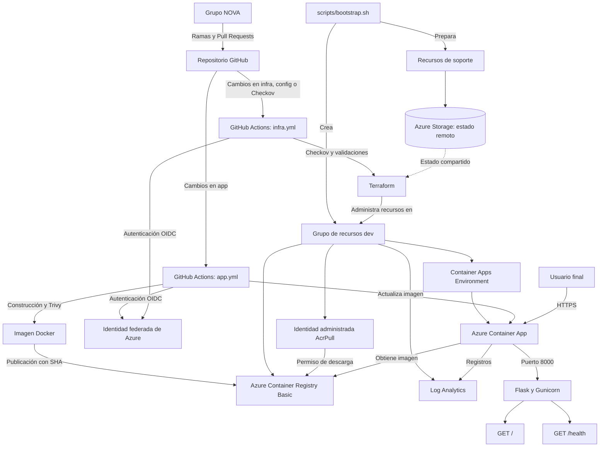

# Arquitectura técnica — Grupo NOVA

**Proyecto:** Infraestructura y despliegue automatizado en Azure  
**Equipo:** NOVA
**Ambiente:** `dev`  
**Región:** `brazilsouth`

## 1. Cómo organizamos nuestra solución

Para desplegar nuestra aplicación en Azure separamos el trabajo en dos procesos. Terraform administra los recursos de infraestructura, mientras que GitHub Actions construye, analiza y publica las imágenes Docker de nuestra aplicación Flask.

La configuración utiliza Azure Container Registry para las imágenes, Azure Container Apps para ejecutar el servicio, Log Analytics para los registros y Azure Storage para el estado remoto de Terraform. Los workflows se autentican en Azure mediante OIDC.

## 2. Diagrama de arquitectura

El diagrama refleja los componentes que configuramos y cuya operación principal comprobamos con los archivos de Terraform y las ejecuciones de GitHub Actions. No sustituye las evidencias de los recursos existentes en Azure.

## 3. Componentes principales

**GitHub y GitHub Actions.** Guardamos el código, la infraestructura y la documentación en un mismo repositorio. Utilizamos ramas y Pull Requests para organizar los cambios. El workflow `app.yml` se encarga de la imagen y del despliegue de la aplicación; `infra.yml` ejecuta Checkov, las validaciones, el plan y la aplicación de Terraform.

**Terraform y Azure Storage.** Definimos los recursos en `infra/`. El script `scripts/bootstrap.sh` prepara primero los grupos de recursos, la identidad federada y el almacenamiento del estado remoto. Después, Terraform administra los recursos del proyecto dentro de `rg-nova-t2-dev`.

**Azure Container Registry.** Utilizamos ACR Basic para almacenar imágenes etiquetadas con el SHA del commit. Deshabilitamos la cuenta administradora y configuramos una identidad con `AcrPull` para que Container Apps descargue las imágenes.

**Azure Container Apps.** Nuestra aplicación se ejecuta con perfil Consumption, acceso HTTPS y un contenedor que escucha en el puerto `8000`. El modo de revisiones configurado es `Single`.

**Log Analytics.** Reúne los registros operativos y tiene una retención de 30 días, con una cuota diaria de `0.5 GB` para controlar su consumo.

## 4. Configuración comprobada

| Parámetro | Valor |
|---|---|
| Aplicación | Python 3.12, Flask y Gunicorn |
| Puerto del contenedor | `8000` |
| Rutas | `GET /` y `GET /health` |
| Acceso externo | HTTPS |
| CPU por réplica | `0.25` vCPU |
| Memoria por réplica | `0.5Gi` |
| Escalado | Mínimo `1`, máximo `2` réplicas |
| Región | `brazilsouth` |
| Modo de revisiones | `Single` |
| Variables no sensibles | `APP_ENV=dev` y `TEAM_NAME=NOVA` |
| Secreto | `APP_SECRET`, referenciado como secreto de Container Apps |

Los valores de CPU, memoria, réplicas y etiquetas se comprobaron en `docs/evidencias/09-limites-y-etiquetas.txt`. Los cambios posteriores de la etiqueta `version_infra` se registraron en `docs/evidencias/07-cambio-etiqueta.txt`.

La ruta principal devuelve un mensaje, el ambiente y la versión; `/health` devuelve `status: ok` y la versión. El código actual utiliza `v2` como valor predeterminado de `APP_VERSION`.

## 5. Cómo funciona cada despliegue

### Infraestructura

Cuando modificamos `infra/`, `config/` o la configuración de Checkov, el workflow valida el formato, ejecuta Checkov y comprueba Terraform. En `main`, después de estas verificaciones, continúa con `terraform plan` y `terraform apply` utilizando el backend remoto y OIDC.

Comprobamos estas etapas en la [ejecución de infraestructura](https://github.com/ISCOUTB/nova-parcial2/actions/runs/38744864451).

### Aplicación

Cuando modificamos `app/`, el workflow construye la imagen, ejecuta Trivy y, desde `main`, la publica en ACR con el SHA del commit. Después actualiza la imagen de la Container App y comprueba `/health`.

Esta secuencia se verificó en la [ejecución de la versión v2](https://github.com/ISCOUTB/nova-parcial2/actions/runs/38687530318).

## 6. Seguridad y control de costos

Utilizamos OIDC para autenticar los workflows, permisos mínimos para descargar imágenes y un usuario sin privilegios para ejecutar la aplicación dentro del contenedor. También aplicamos Checkov y Trivy como controles previos a la publicación.

Elegimos ACR Basic y recursos limitados por tratarse de un taller académico. Documentamos las ocho excepciones de Checkov junto con sus medidas compensatorias y riesgos residuales en [docs/decisiones.md](decisiones.md). El control de gastos y el procedimiento de destrucción están en [docs/destruccion-y-costos.md](destruccion-y-costos.md).

## 7. Acceso y revisiones

La aplicación quedó publicada en:

https://ca-nova-t2-dev.bravepond-62a4a131.brazilsouth.azurecontainerapps.io

Las pruebas del cambio de `v1` a `v2` quedaron asociadas a los commits `2e8b26f` y `3cfe621`. El archivo `docs/evidencias/06-revisiones-e-imagenes.txt` muestra ambas imágenes en ACR y la respuesta pública de `v2`.

En la consulta de revisiones de Azure se observó únicamente `ca-nova-t2-dev--latest`. Aunque el modo `Single` mantiene una sola revisión activa, el historial disponible en nuestro ambiente no permitió mostrar dos revisiones diferenciadas. Por eso respaldamos el cambio con los pipelines, los SHA y las respuestas HTTP, sin afirmar que Azure Container Apps nunca conserve revisiones anteriores.

## 8. Evidencias relacionadas

Para comprobar la arquitectura usamos los archivos Terraform, los workflows y los reportes de `docs/evidencias/`. Los enlaces a las ejecuciones, las capturas de Azure, la seguridad y las pruebas de la aplicación están reunidos en [docs/evidencias/registro.md](evidencias/registro.md).

**Requisito relacionado:** R15 — Diagrama y descripción de arquitectura.