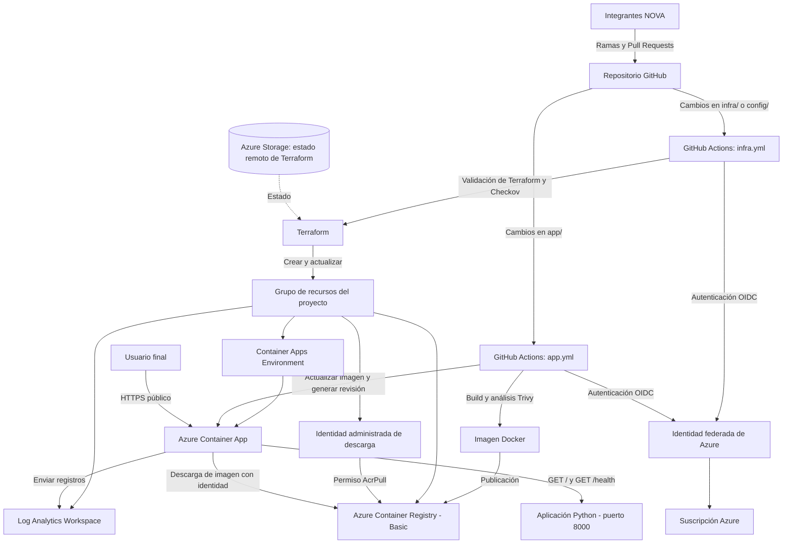

# Arquitectura técnica — Taller 2 NOVA

**Proyecto:** Despliegue de una aplicación HTTP en Azure Container Apps mediante Terraform y GitHub Actions  
**Equipo:** NOVA (Sofía, Sara, Ana y Bianca)  
**Responsable de documentación:** Bianca  
**Estado del documento:** Arquitectura propuesta; el despliegue y los controles deben verificarse antes de marcar requisitos como cumplidos.

## 1. Objetivo

Describir la arquitectura prevista para publicar una aplicación HTTP de Python en Azure Container Apps y automatizar dos procesos distintos: cambios de la aplicación y cambios de infraestructura. La solución utiliza Terraform para declarar recursos, GitHub Actions para ejecutar los pipelines y controles de seguridad Checkov y Trivy.

## 2. Diagrama de arquitectura

> **Nota:** El diagrama representa la arquitectura objetivo. No constituye evidencia de que todos estos recursos existan actualmente en Azure.

## 3. Componentes y función

- **GitHub:** almacena el código fuente y la documentación. Cada integrante trabaja en su rama y propone cambios mediante Pull Requests.
- **GitHub Actions (`app.yml`):** construye la imagen, ejecuta Trivy, la publica en Azure Container Registry y, cuando corresponda, actualiza la imagen de la Container App.
- **GitHub Actions (`infra.yml`):** ejecuta las validaciones de Terraform y Checkov, genera un plan y aplica cambios de infraestructura según la rama y las reglas acordadas.
- **OIDC:** permite que GitHub Actions se autentique en Azure con una credencial federada de duración limitada, sin almacenar una contraseña o client secret permanente.
- **Terraform:** declara la infraestructura de Azure y utiliza un backend remoto para almacenar su estado.
- **Azure Storage:** conserva el estado remoto de Terraform; se prepara una sola vez por fuera de la infraestructura principal.
- **Azure Container Registry (ACR Basic):** almacena las imágenes Docker de la aplicación.
- **Identidad administrada de descarga:** concede a la Container App el rol `AcrPull` sobre ACR para obtener imágenes sin usar contraseñas del registro.
- **Azure Container Apps Environment:** aloja y administra la ejecución de la aplicación.
- **Azure Container App:** expone la aplicación por HTTPS, dirige solicitudes al puerto 8000 y gestiona las revisiones de despliegue.
- **Log Analytics:** centraliza los registros operativos, evitando registrar secretos.

## 4. Configuración objetivo de la aplicación

| Parámetro | Valor previsto |
|---|---|
| Lenguaje y servicio | Python con aplicación HTTP |
| Puerto interno | `8000` |
| Ruta principal | `GET /` |
| Ruta de salud | `GET /health`, respuesta HTTP 200 con `{"status":"ok"}` |
| Acceso externo | HTTPS mediante el ingreso de Azure Container Apps |
| CPU | `0.25` vCPU |
| Memoria | `0.5Gi` |
| Réplicas | Mínimo `1`, máximo `2` |
| Variables no sensibles | `APP_ENV=dev`, `TEAM_NAME=NOVA` |
| Secreto | `APP_SECRET`, almacenado como secreto, sin exponer su valor |
| Versión | Identificador visible en `/`, actualizable para demostrar v1 → v2 |

## 5. Flujo de despliegue previsto

1. **Revisión de código:** la integrante crea una rama, realiza los cambios y abre un Pull Request para revisión.
2. **Infraestructura:** al integrar cambios de `infra/` o `config/`, el pipeline valida y aplica la configuración con Terraform; Checkov revisa riesgos de infraestructura.
3. **Aplicación:** al integrar cambios de `app/`, el pipeline construye la imagen, ejecuta Trivy y publica la versión en ACR.
4. **Actualización:** GitHub Actions actualiza la imagen de Azure Container Apps, generando una nueva revisión para la demostración.
5. **Comprobación:** se consultan la URL pública y `/health`; las ejecuciones y los resultados de seguridad se guardan como evidencias.

**Arranque inicial:** la identidad federada y el almacenamiento del estado se crean previamente. El equipo debe coordinar la primera imagen y la creación de Container Apps para evitar referencias a una imagen privada inexistente.

## 6. Seguridad y costos

- No se guardan contraseñas, tokens ni valores de secretos en el repositorio o en capturas.
- OIDC autentica los pipelines; una identidad administrada con `AcrPull` permite descargar imágenes de ACR.
- Checkov revisa Terraform; Trivy analiza la imagen Docker antes de publicarla.
- Los límites previstos son `0.25` vCPU, `0.5Gi` y hasta dos réplicas, con ACR Basic.
- El almacenamiento de estado y los recursos de Azure pueden generar costos. No se destruyen recursos antes de la evaluación del profesor.

## 7. Validaciones y evidencias pendientes

- [ ] Confirmar la configuración final en `infra/` y `config/` con Sofía.
- [ ] Confirmar el comportamiento de `app.yml` e `infra.yml` con Ana.
- [ ] Confirmar endpoints y contenedor ejecutable con Sara.
- [ ] Capturar el despliegue real de Azure Container Apps, sus revisiones, réplicas y URL pública.
- [ ] Guardar las ejecuciones de Checkov y Trivy en `docs/evidencias/`.
- [ ] Actualizar este diagrama si la arquitectura implementada difiere del diseño propuesto.

**Requisito relacionado:** R15 (diagrama de arquitectura). La creación de este documento no implica que R15 esté validado; se necesita revisar que el diagrama coincida con la solución real.
