# Registro de evidencias — Grupo NOVA

**Proyecto:** Infraestructura y despliegue automatizado en Azure  
**Equipo:** NOVA 
**Repositorio:** https://github.com/ISCOUTB/nova-parcial2  

## 1. ¿Qué registramos aquí?

Durante el desarrollo realizamos pruebas locales, análisis de seguridad y despliegues en Azure. En este documento reunimos las capturas, los reportes y los enlaces con los que podemos mostrar lo que hicimos y los resultados que obtuvimos.

El estado de los 25 requisitos se consulta en [la matriz de requisitos](../matriz-requisitos.md). Aquí nos concentramos en **dónde está cada evidencia** para no repetir la misma explicación en varios documentos.

## 2. Repositorio y Pull Requests

Utilizamos ramas y Pull Requests para organizar el trabajo de las cuatro integrantes.

**Repositorio:** https://github.com/ISCOUTB/nova-parcial2

| PR | Evidencia de trabajo |
|---|---|
| #32 | Configuración y primer análisis de Checkov. |
| #34 | Análisis local de Trivy. |
| #36 | Primer documento de decisiones técnicas. |
| #38 | Matriz de requisitos R1–R25. |
| #39 | Documentación del README. |
| #40 | Cambio de la aplicación de `v1` a `v2`. |
| #43 | Excepciones justificadas de Checkov. |
| #47 | Cambio de la etiqueta de infraestructura `version_infra`. |
| #48 | Integración de capturas de evidencia. |

Estos registros permiten consultar los cambios realizados y cómo llegaron a `main`.

## 3. Pipeline de aplicación: GitHub Actions

**Resultado: verificado.** El workflow `.github/workflows/app.yml` construyó la imagen Docker, ejecutó Trivy, se autenticó en Azure con OIDC, publicó la imagen en ACR con una etiqueta SHA, actualizó Container Apps y comprobó `/health`.

- [Ejecución anterior, `v1`](https://github.com/ISCOUTB/nova-parcial2/actions/runs/38685137897).
- [Ejecución posterior, `v2`](https://github.com/ISCOUTB/nova-parcial2/actions/runs/38687530318).

La siguiente captura muestra el pipeline después del cambio a `v2`:

El cambio se integró mediante el PR #40:

## 4. Pipeline de infraestructura

**Resultado: verificado.** En `.github/workflows/infra.yml` comprobamos el análisis Checkov, las validaciones de Terraform, la planificación y la aplicación de cambios desde `main`.

[Ejecución con Checkov, plan y apply](https://github.com/ISCOUTB/nova-parcial2/actions/runs/38744864451)

Conservamos capturas de las distintas etapas:

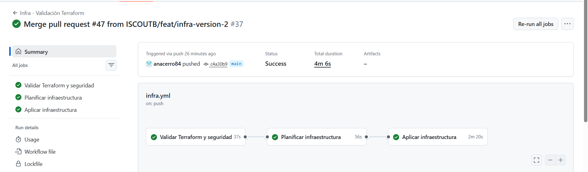

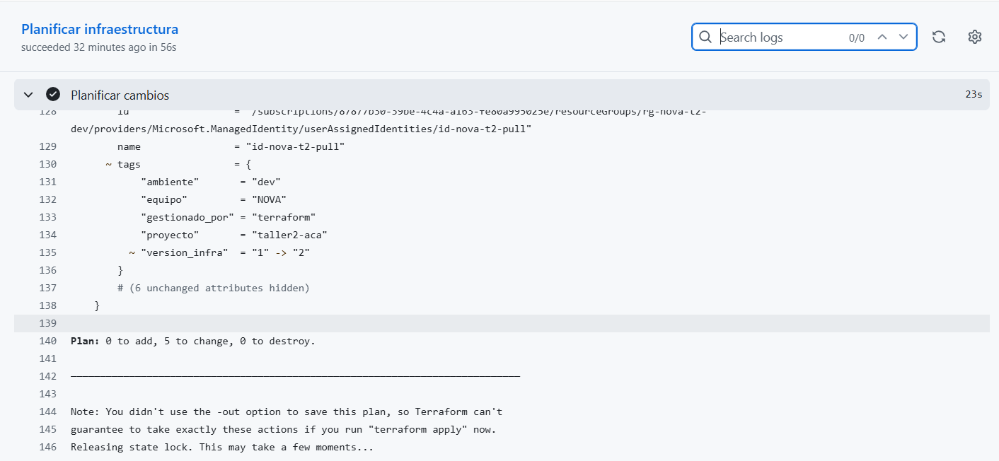

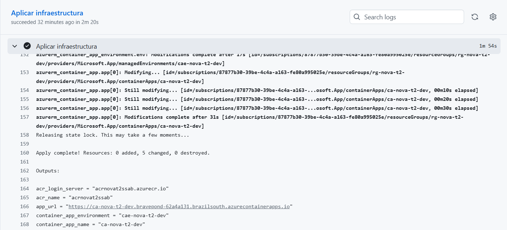

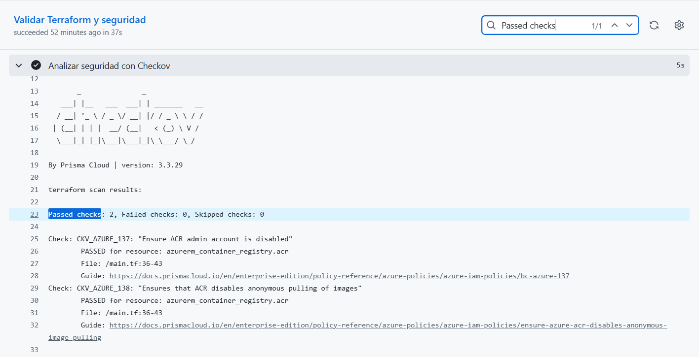

### Demostración de cambio independiente

Modificamos la etiqueta `version_infra` de `1` a `2` mediante el PR #47. El reporte `07-cambio-etiqueta.txt` confirma que los recursos consultados tenían el nuevo valor después de `terraform apply`.

**Reporte:** [07-cambio-etiqueta.txt](./07-cambio-etiqueta.txt).

## 5. Autenticación OIDC

**Resultado: autenticación verificada en los pipelines.** Utilizamos una identidad federada para que GitHub Actions pudiera iniciar sesión en Azure sin una contraseña permanente de despliegue.

[Ejecución adicional de prueba OIDC](https://github.com/ISCOUTB/nova-parcial2/actions/runs/38679307234)

**Revisión final:** comprobar permisos asignados y confirmar que no haya valores sensibles expuestos en archivos, registros o capturas. Una ejecución correcta de OIDC no reemplaza esa revisión.

## 6. Checkov: análisis de infraestructura

**Resultado: primer análisis, excepciones documentadas y ejecución automatizada.**

| Análisis | Aprobados | Fallidos | Omitidos contabilizados |
|---|---:|---:|---:|
| Inicial | 2 | 8 | 0 |
| Posterior a `skip-check` | 2 | 0 | 0 |

En el primer análisis identificamos ocho controles fallidos sobre ACR. Los revisamos con Sofía y documentamos las justificaciones, medidas compensatorias y riesgos residuales en [docs/decisiones.md](../decisiones.md).

El reporte posterior no muestra los ocho controles porque fueron excluidos mediante `skip-check`: **no debemos confundir esa exclusión con la corrección de los riesgos**.

**Reportes:**

- [checkov-terraform.txt](./checkov-terraform.txt) — análisis inicial.
- [checkov-excepciones-2026-10-15.txt](./checkov-excepciones-2026-10-15.txt) — análisis posterior.
- `.checkov.yaml` — configuración del repositorio.

El análisis automatizado quedó registrado en la [ejecución de infraestructura](https://github.com/ISCOUTB/nova-parcial2/actions/runs/38744864451) y en la captura `07d-checkov.png`.

## 7. Trivy: seguridad de la imagen Docker

**Resultado: pruebas local y automatizada verificadas.** Analizamos la imagen local `nova-app:seguridad` con Trivy 0.69.3. No se encontraron vulnerabilidades HIGH ni CRITICAL con corrección disponible bajo los filtros utilizados.

**Reporte local:** [trivy-resultado.md](./trivy-resultado.md).

Después comprobamos el análisis de Trivy en GitHub Actions. Conservamos sus resultados en dos capturas:

[Ejecución automatizada de Trivy](https://github.com/ISCOUTB/nova-parcial2/actions/runs/38687530318)

La columna de secretos del reporte aparece como «Not scanned», así que no afirmamos que se haya realizado un análisis de secretos. Tampoco consideramos las pruebas como una garantía de ausencia de vulnerabilidades de otras severidades.

## 8. Construcción Docker y pruebas de Sara

**Resultado: construcción y pruebas locales registradas.** Sara preparó la aplicación Flask con Gunicorn, un usuario sin privilegios y los endpoints `/` y `/health`. Estas capturas muestran la ejecución local y las pruebas automatizadas.

El Dockerfile y las pruebas originales se pueden consultar en `app/Dockerfile` y `app/test_app.py`.

## 9. Azure Container Registry

**Resultado: publicación de imágenes verificada.** El pipeline publicó imágenes en ACR utilizando etiquetas basadas en el SHA completo del commit.

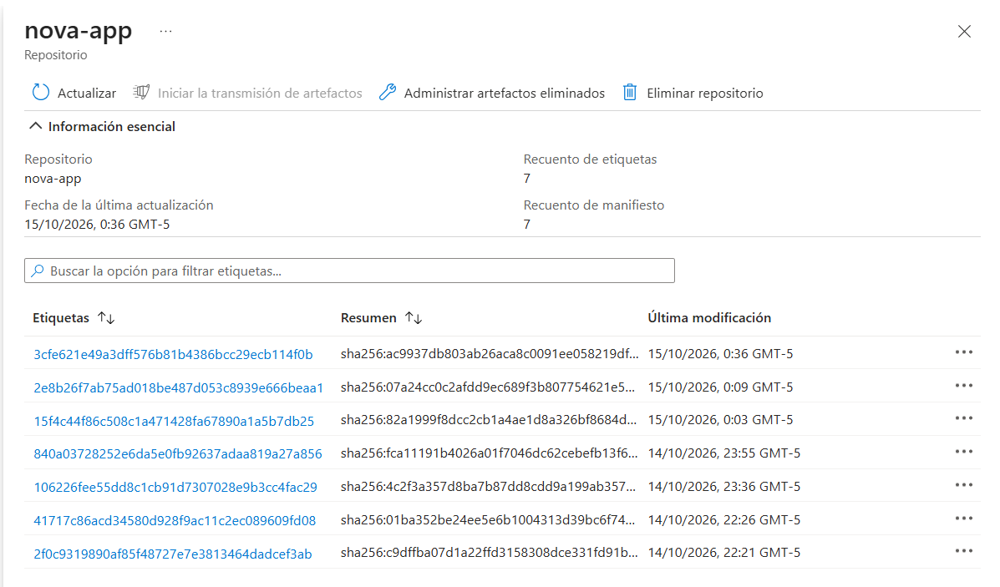

También comprobamos las etiquetas en [06-revisiones-e-imagenes.txt](./06-revisiones-e-imagenes.txt), donde figuran tanto `2e8b26f7ab75ad018be487d053c8939e666beaa1` (`v1`) como `3cfe621e49a3dff576b81b4386bcc29ecb114f0b` (`v2`).

## 10. Aplicación pública y pruebas de Azure Container Apps

**Resultado: publicación HTTPS y respuesta de `v2` comprobadas.** La dirección de nuestra aplicación es:

https://ca-nova-t2-dev.bravepond-62a4a131.brazilsouth.azurecontainerapps.io

El reporte de Sofía registra que `GET /` devolvió `version: v2` y `GET /health` devolvió `status: ok`, también con `v2`.

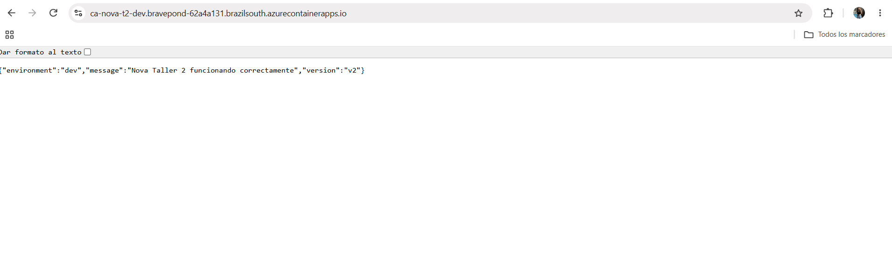

Comprobaremos nuevamente la URL antes de la sustentación, ya que la aplicación solo responde mientras los recursos estén activos.

## 11. Revisiones y cambio de versión

**Resultado: cambio `v1 → v2` demostrado; comparación directa de revisiones limitada.**

El pipeline de `v1` corresponde al commit `2e8b26f` y el de `v2` al commit `3cfe621`. Conservamos ambas imágenes en ACR y la aplicación desplegada respondió con `v2`.

En la consulta de Azure se observó una sola revisión, `ca-nova-t2-dev--latest`, asociada a la imagen de `v2`. La configuración utiliza `revision_mode = "Single"`.

**Archivo principal:** [06-revisiones-e-imagenes.txt](./06-revisiones-e-imagenes.txt).

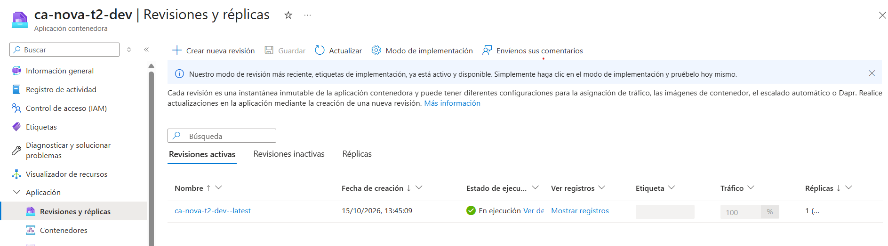

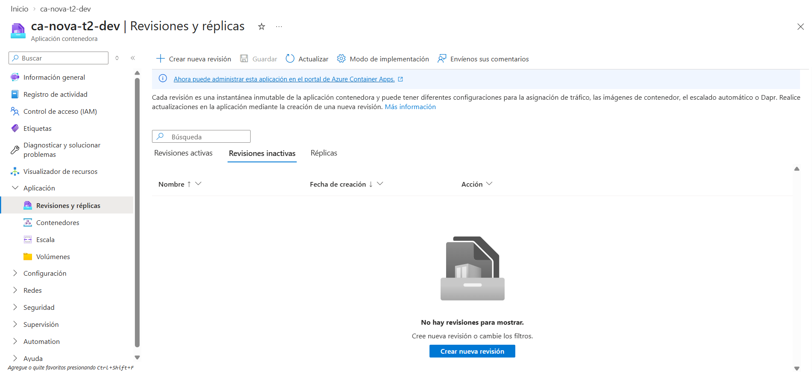

No tenemos dos identificadores de revisión distintos para mostrar la revisión anterior y la nueva. Documentamos esa limitación en `docs/decisiones.md` y en la matriz R1–R25. No confundimos las dos imágenes SHA con dos revisiones visibles de Azure.

## 12. Etiquetas, límites y escalado

**Resultado: valores comprobados en Azure.** El reporte `09-limites-y-etiquetas.txt` registra los recursos desplegados y sus parámetros: CPU `0.25`, memoria `0.5Gi`, una réplica mínima, dos máximas y modo `Single`.

[09-limites-y-etiquetas.txt](./09-limites-y-etiquetas.txt)

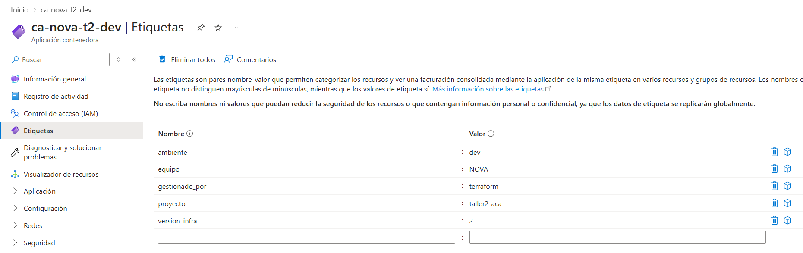

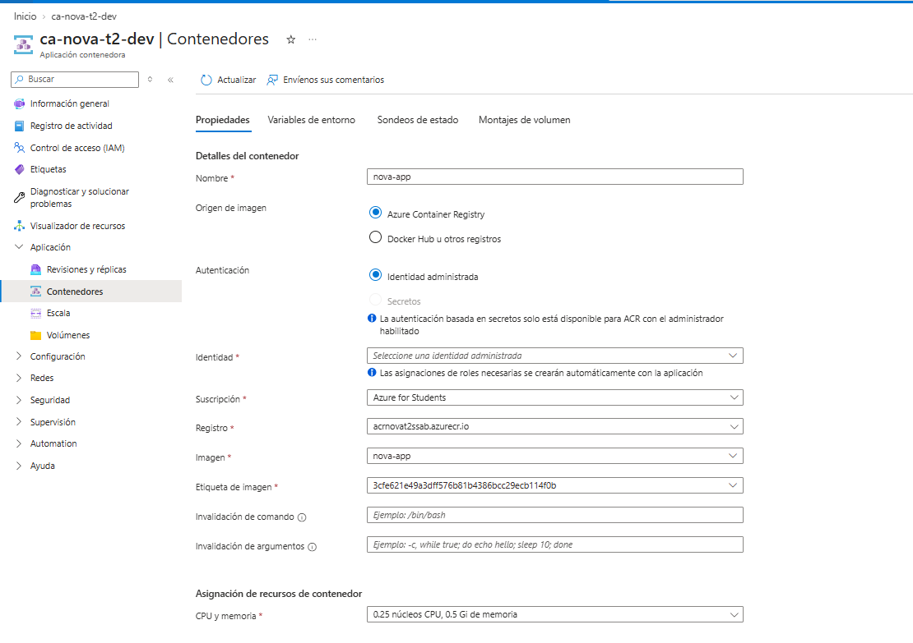

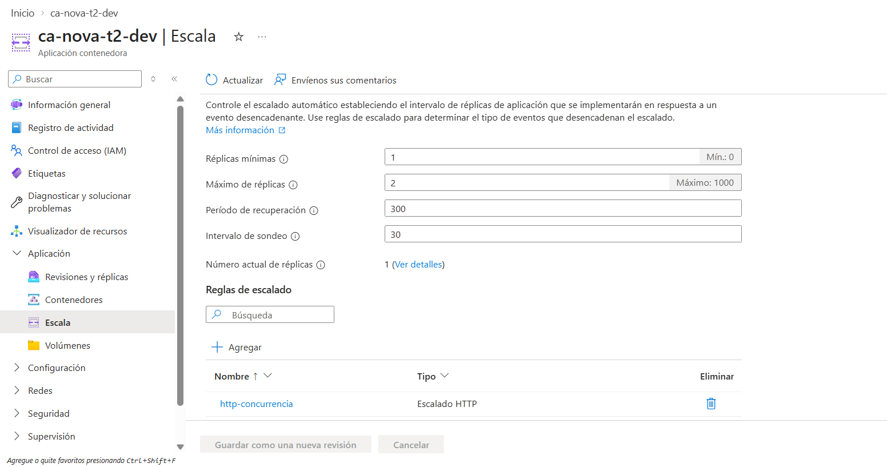

También contamos con [07-cambio-etiqueta.txt](./07-cambio-etiqueta.txt), que registra el cambio efectivo de `version_infra` de `1` a `2`.

## 13. Costos y eliminación de infraestructura

**Resultado: configuración de costos y procedimiento documentados.** Utilizamos ACR Basic, Container Apps Consumption, límites de recursos y una cuota diaria de Log Analytics. El procedimiento de eliminación está en [docs/destruccion-y-costos.md](../destruccion-y-costos.md) y el script en `scripts/destroy.sh`.

Sofía también generó un plan de destrucción para comprobar qué recursos se eliminarían, **sin ejecutar la destrucción**.

[10-plan-destroy.txt](./10-plan-destroy.txt)

Los recursos deben permanecer disponibles hasta que termine la evaluación del profesor.

## 14. Revisión final para la entrega

Antes de entregar, comprobamos que los archivos y las capturas estén publicados en `main`, que la URL responda, y que cada requisito tenga un enlace o reporte que lo respalde. También revisamos que no haya secretos expuestos en el repositorio o las imágenes.

Los requisitos R22 y R24 mantienen la limitación del historial de revisiones, aunque el cambio de versión y las imágenes SHA están documentados. La sustentación y la revisión final de permisos continúan siendo actividades de cierre del equipo.
