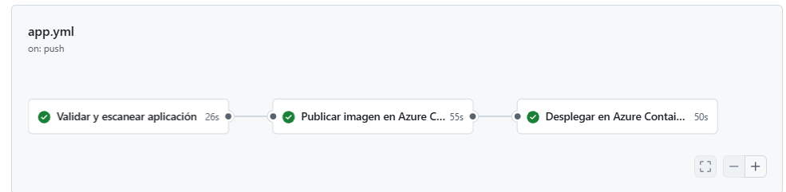
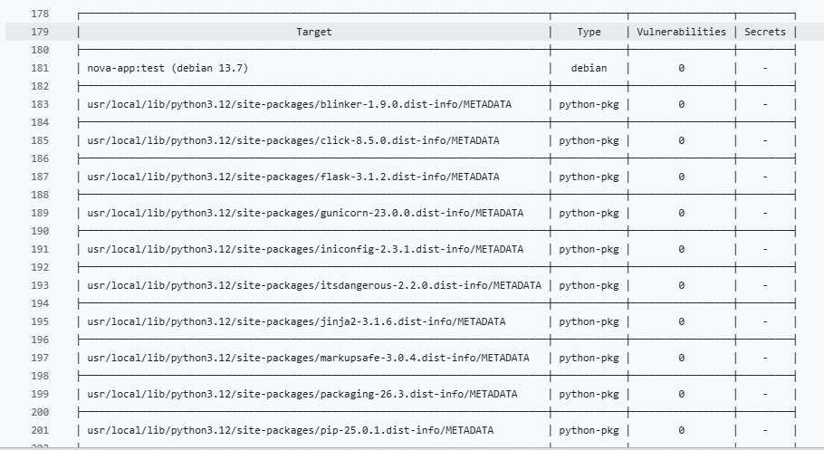
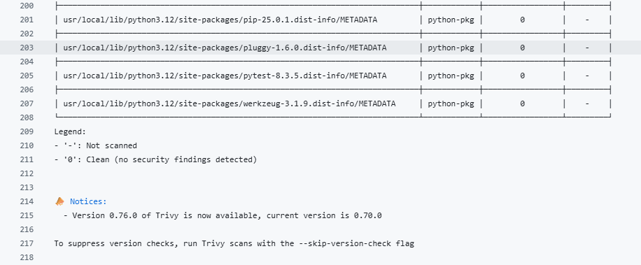
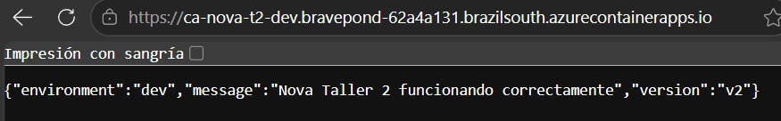
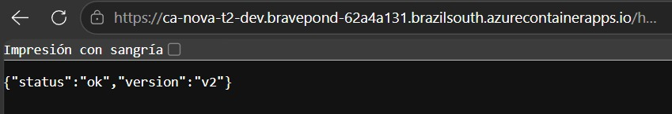
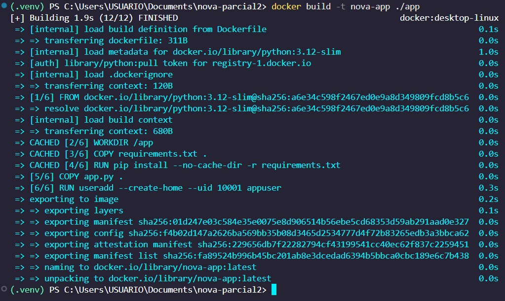
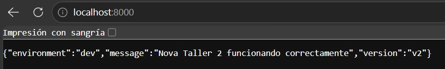
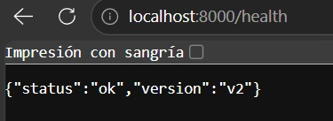
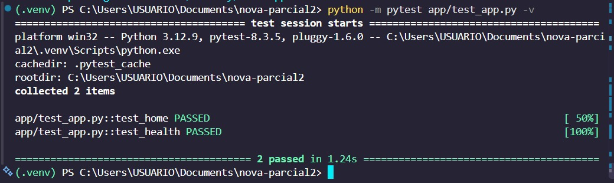
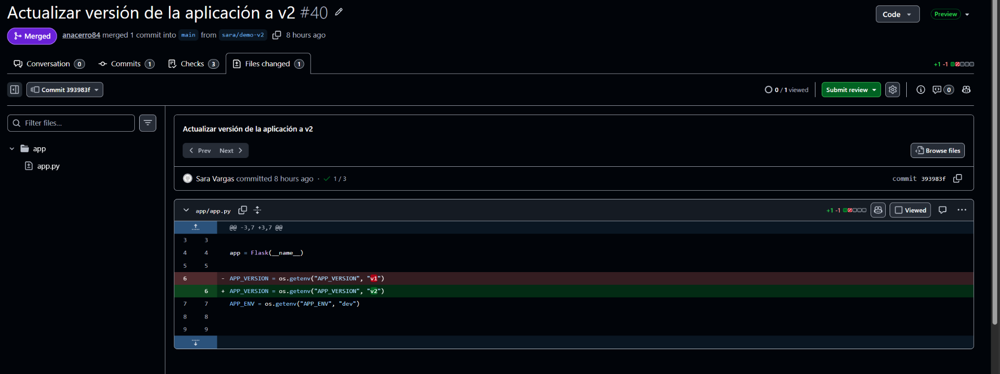

# Registro de evidencias — Proyecto NOVA

**Proyecto:** Taller 2 — Infraestructura y despliegue automatizado en Azure
**Equipo:** NOVA (Sofía, Sara, Ana y Bianca)
**Repositorio:** https://github.com/ISCOUTB/nova-parcial2

## 1. Objetivo

Este documento reúne las evidencias disponibles del desarrollo del Taller 2 del Grupo NOVA, incluyendo el repositorio, la infraestructura Terraform, los workflows de GitHub Actions, las pruebas de seguridad y el despliegue de la aplicación en Azure.

Su propósito es facilitar la revisión de los requisitos solicitados por el profesor y diferenciar las actividades comprobadas de aquellas que todavía requieren evidencias adicionales.

## 2. GitHub y control de versiones

**Estado:** Verificado.

El proyecto se encuentra publicado en GitHub y utiliza ramas y Pull Requests para organizar los cambios realizados por las integrantes.

**Evidencias disponibles:**

- Repositorio: https://github.com/ISCOUTB/nova-parcial2
- PR #32: configuración y resultados de Checkov.
- PR #34: documentación del análisis de Trivy.
- PR #36: decisiones técnicas y limitaciones.
- PR #38: actualización de la matriz R1–R25.
- PR #39: ampliación del README principal.

**Pendiente:** Conservar una captura de las reglas de protección de la rama `main`, si están configuradas.

## 3. GitHub Actions — Aplicación

**Estado:** Ejecución exitosa verificada.

Se comprobó una ejecución del workflow `App - Validación, seguridad y despliegue` en la rama `main`.

**Ejecución:**

https://github.com/ISCOUTB/nova-parcial2/actions/runs/38685137897

**Etapas verificadas:**

- Construcción de la imagen Docker.
- Análisis de vulnerabilidades con Trivy.
- Autenticación en Azure mediante OIDC.
- Inicio de sesión en Azure Container Registry.
- Publicación de la imagen Docker con etiqueta basada en el SHA del commit.
- Actualización de la imagen en Azure Container Apps.
- Comprobación satisfactoria del endpoint `/health`.

Estas etapas finalizaron correctamente en la ejecución consultada.

### Evidencia gráfica

La siguiente captura muestra la ejecución exitosa del workflow posterior al merge a `main`, incluyendo la validación de la aplicación, la publicación de la imagen en Azure Container Registry y el despliegue en Azure Container Apps.

**Pendiente:** Completar la evidencia de las revisiones anterior y nueva de Azure Container Apps.

## 4. GitHub Actions — Infraestructura

**Estado:** Validación y planificación verificadas.

El workflow `Infra - Validación Terraform` cuenta con una ejecución exitosa.

**Ejecución:**

https://github.com/ISCOUTB/nova-parcial2/actions/runs/38683030473

**Etapas verificadas:**

- Instalación de Terraform.
- Comprobación de formato mediante `terraform fmt`.
- Inicialización de Terraform sin backend para validar la configuración.
- Validación mediante `terraform validate`.
- Autenticación OIDC.
- Inicialización con backend remoto.
- Ejecución de `terraform plan`.

**Limitaciones:**

La versión del workflow revisada todavía no incluye la ejecución automatizada de Checkov ni de `terraform apply`.

**Pendiente:** Coordinar con Ana y Sofía las validaciones faltantes y conservar sus evidencias cuando estén disponibles.

## 5. Autenticación OIDC

**Estado:** Funcionamiento verificado en GitHub Actions.

Se comprobó que los pasos de inicio de sesión en Azure mediante OIDC finalizaron correctamente en ejecuciones de los workflows de aplicación e infraestructura.

Esto permite que GitHub Actions se autentique en Azure mediante identidad federada, sin requerir una contraseña permanente de Azure en el código.

**Evidencia adicional de prueba OIDC:**

https://github.com/ISCOUTB/nova-parcial2/actions/runs/38679307234

**Pendiente:** Realizar una revisión final de la configuración de permisos y verificar que no existan secretos expuestos en archivos o capturas.

## 6. Análisis de seguridad — Checkov

**Estado:** Análisis local realizado, con hallazgos pendientes.

Se ejecutó Checkov sobre la infraestructura Terraform del proyecto.

**Resultados:**

| Resultado | Cantidad |
|---|---:|
| Controles aprobados | 2 |
| Controles fallidos | 8 |
| Controles omitidos | 0 |

Los controles aprobados corresponden a la deshabilitación de la cuenta administradora de ACR y de las descargas anónimas.

Los ocho controles fallidos están relacionados con características de seguridad, conectividad y disponibilidad de Azure Container Registry.

**Archivo de evidencia:**

`docs/evidencias/checkov-terraform.txt`

**Pendiente:**

- Revisar los ocho hallazgos con Sofía.
- Corregir los controles que sea viable solucionar.
- Documentar las limitaciones y excepciones justificadas.
- Comprobar la integración de Checkov en GitHub Actions.

No se considera finalizada la revisión de seguridad de infraestructura mientras estos puntos permanezcan abiertos.

## 7. Análisis de seguridad — Trivy

**Estado:** Análisis local y ejecución automatizada realizados.

Se ejecutó Trivy 0.69.3 sobre la imagen `nova-app:seguridad`.

**Resultados del análisis local:**

| Severidad | Vulnerabilidades detectadas |
|---|---:|
| HIGH | 0 |
| CRITICAL | 0 |

El análisis utilizó `--severity HIGH,CRITICAL` y `--ignore-unfixed`, por lo que el resultado se limita a las vulnerabilidades incluidas en esos criterios.

Adicionalmente, se comprobó que Trivy se ejecutó correctamente dentro del workflow de aplicación.

**Archivo de evidencia:**

`docs/evidencias/trivy-resultado.md`

**Evidencia automatizada:**

https://github.com/ISCOUTB/nova-parcial2/actions/runs/38685137897

### Evidencias gráficas

Las siguientes capturas muestran los resultados obtenidos durante el análisis de seguridad de la imagen con Trivy.

**Pendiente:** Conservar una captura de la ejecución automatizada para la sustentación.

## 8. Azure Container Registry

**Estado:** Publicación de imagen verificada.

El workflow de aplicación confirmó la autenticación en ACR, la construcción de la imagen con el SHA del commit y su publicación en el registro.

La infraestructura utiliza Azure Container Registry Basic y tiene deshabilitada la cuenta administradora.

**Evidencia:**

https://github.com/ISCOUTB/nova-parcial2/actions/runs/38685137897

**Pendiente:** Guardar una captura de Azure Portal que muestre el registro, el repositorio de imágenes y la etiqueta publicada.

## 9. Azure Container Apps

**Estado:** Actualización y endpoint de salud verificados.

La ejecución exitosa del pipeline confirmó que se pudo actualizar la imagen de la Container App y consultar satisfactoriamente el endpoint `/health`.

La infraestructura Terraform declara ingreso externo, conexión HTTPS, CPU de 0.25 vCPU, memoria de 0.5 GiB y escalado entre una y dos réplicas.

**Evidencia:**

https://github.com/ISCOUTB/nova-parcial2/actions/runs/38685137897

### Evidencia de aplicación desplegada

**URL pública:**

https://ca-nova-t2-dev.bravepond-62a4a131.brazilsouth.azurecontainerapps.io/

Se verificó que la aplicación desplegada en Azure Container Apps responde correctamente y muestra la versión `v2`.

También se comprobó el endpoint público `/health`:

https://ca-nova-t2-dev.bravepond-62a4a131.brazilsouth.azurecontainerapps.io/health

El endpoint respondió correctamente con estado `ok` y versión `v2`.

**Pendiente:**

- Verificar las etiquetas de los recursos en Azure.
- Comprobar CPU, memoria y réplicas configuradas.
- Guardar evidencia de las revisiones de Azure Container Apps.

### 9.1. Evidencias de contenedorización y validación local

Se realizó la construcción local de la imagen Docker de la aplicación utilizando el archivo `app/Dockerfile`.

Se verificó el funcionamiento local del endpoint principal de la aplicación en el puerto 8000.

También se comprobó correctamente el endpoint local `/health`.

Finalmente, se ejecutaron las pruebas automáticas definidas en `app/test_app.py`, obteniendo dos pruebas aprobadas correctamente.

## 10. Demostración de cambios de versión

**Estado:** En proceso.

La aplicación cuenta con un mecanismo para mostrar su versión mediante la variable `APP_VERSION`.

### Evidencia del cambio de aplicación

Se realizó un cambio controlado en `app/app.py`, actualizando la versión de la aplicación de `v1` a `v2`. El cambio fue integrado mediante el Pull Request #40 desde la rama `sara/demo-v2` hacia `main`.

Después del merge, GitHub Actions ejecutó automáticamente el pipeline de aplicación.

La nueva versión quedó disponible públicamente en Azure Container Apps:

El endpoint de salud también confirmó el funcionamiento de la nueva versión:

Para demostrar el despliegue automático de una nueva versión se necesita comprobar un cambio del código de la aplicación, su integración a `main` y la correspondiente actualización de Azure Container Apps.

**Estado de las evidencias:**

- [ ] Versión anterior `v1` visible en la aplicación.
- [x] Cambio de `v1` a `v2` realizado en GitHub.
- [x] Ejecución exitosa de GitHub Actions.
- [x] Nueva versión `v2` visible después del despliegue.
- [ ] Lista de revisiones de Azure Container Apps.

La demostración del despliegue automático de `v2` fue verificada. Queda pendiente incorporar la evidencia de la versión anterior y de las revisiones de Azure Container Apps para completar la comparación entre ambas versiones.

## 11. Documentación técnica

**Estado:** Documentos publicados.

El repositorio contiene:

| Documento | Finalidad |
|---|---|
| `README.md` | Presentación, arquitectura, configuración, despliegue y acceso |
| `docs/arquitectura.md` | Descripción y diagrama de arquitectura |
| `docs/matriz-requisitos.md` | Seguimiento de los 25 requisitos |
| `docs/decisiones.md` | Decisiones técnicas, limitaciones y mejoras |
| `docs/evidencias/checkov-terraform.txt` | Resultado del análisis Checkov |
| `docs/evidencias/trivy-resultado.md` | Resultado del análisis local Trivy |
| `docs/evidencias/registro.md` | Consolidación de evidencias del proyecto |

Algunos documentos deberán actualizarse con los datos finales de Azure antes de la entrega.

## 12. Lista de verificación de evidencias

### Repositorio y documentación

- [x] Repositorio publicado.
- [x] Cambios integrados mediante Pull Requests.
- [x] Diagrama de arquitectura publicado.
- [x] Matriz de requisitos actualizada.
- [x] Documento de decisiones técnicas publicado.
- [x] README ampliado y publicado.
- [ ] Captura de las reglas de protección de `main`.

### Seguridad

- [x] Reporte de Checkov publicado.
- [x] Resultado local de Trivy publicado.
- [x] Ejecución automatizada de Trivy verificada.
- [ ] Revisión final de los ocho hallazgos de Checkov.
- [ ] Ejecución automatizada de Checkov comprobada.
- [ ] Capturas finales de los análisis de seguridad.

### Automatización e infraestructura

- [x] Workflow de aplicación ejecutado correctamente.
- [x] Workflow de validación Terraform ejecutado correctamente.
- [x] Ejecución exitosa de `terraform plan`.
- [x] Inicio de sesión OIDC verificado.
- [x] Imagen Docker publicada en ACR.
- [x] Actualización de Container Apps verificada.
- [x] Endpoint `/health` comprobado.
- [ ] Ejecución automatizada de `terraform apply` comprobada.
- [ ] Demostración diferenciada de cambios de aplicación e infraestructura.

### Azure y sustentación

- [X] URL pública definitiva registrada.
- [X] Captura de la aplicación funcionando.
- [ ] Captura de la imagen y etiqueta